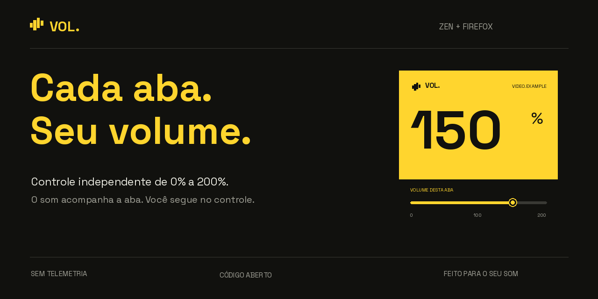
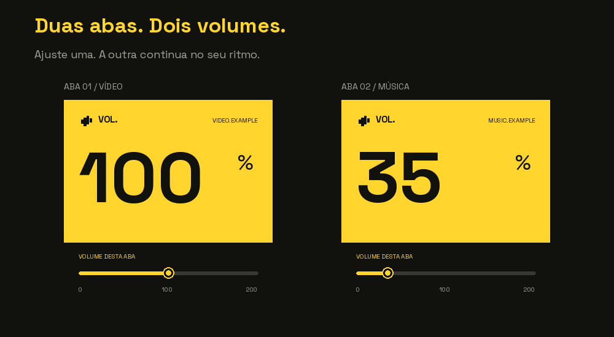
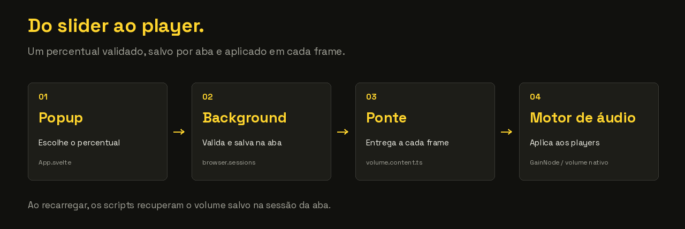

# Vol

[](https://github.com/juicerq/vol/actions/workflows/ci.yml)

**Volume independente por aba para Zen e Firefox. De 0% a 200%.**

Reduza o som de uma aba, amplifique um vídeo em outra e mantenha cada uma no seu volume.



[Baixar a última versão](https://github.com/juicerq/vol/releases/latest) · [Instalar](#instalar) · [Como funciona](#como-funciona) · [Desenvolver](#desenvolver)

## Cada aba no seu volume

- **0% a 200%:** silencie, reduza ou amplifique players compatíveis.
- **Independente por aba:** duas abas do mesmo site podem ter volumes diferentes.
- **Persistência:** o valor acompanha a aba ao navegar, recarregar e restaurar a sessão.
- **Players dinâmicos:** detecta áudio e vídeo adicionados depois do carregamento, inclusive em frames.
- **Sem telemetria:** não envia dados a serviços externos; a fonte também é empacotada localmente.



As imagens são ilustrações da interface baseadas no layout e nos recursos atuais do Vol; não são uma gravação do navegador.

## Instalar

Os pacotes atuais **não têm assinatura da Mozilla**. A instalação permanente exige um navegador e uma configuração que aceitem extensões sem assinatura. O motor de áudio foi verificado no Firefox no desenvolvimento da v0.1.1; a instalação permanente no Zen ainda precisa ser validada.

### Pacote para Zen

1. Baixe o `.xpi` da [última release](https://github.com/juicerq/vol/releases/latest).
2. Em um Zen configurado para aceitar extensões sem assinatura, abra `about:addons`.
3. Na engrenagem, escolha **Instalar extensão de um arquivo** e selecione o `.xpi`.

A configuração relevante é `xpinstall.signatures.required` em `about:config`. A disponibilidade desse modo depende do navegador e da edição; veja as [restrições de assinatura da Mozilla](https://extensionworkshop.com/documentation/publish/signing-and-distribution-overview/). Não é necessário alterar essa preferência para a instalação temporária abaixo.

### Experimentar no Firefox ou Zen

1. [Gere o pacote localmente](#desenvolver).
2. Abra `about:debugging#/runtime/this-firefox` → **Carregar extensão temporária**.
3. Selecione `.output/firefox-mv3/manifest.json`.
4. Abra uma página com áudio ou vídeo e ajuste o volume pelo ícone do Vol. Se a página já estava aberta, recarregue-a.

A instalação temporária é removida ao reiniciar o navegador. As atualizações dos pacotes permanentes são manuais: baixe e instale o `.xpi` da nova release.

## Como funciona

Ao ajustar uma aba para 150%, o popup envia uma mensagem ao background. O valor é validado e salvo na sessão daquela aba; os scripts de cada frame recebem o percentual e o motor de áudio o aplica aos players compatíveis.



O volume pertence à **aba, não ao domínio**. Ao recarregar, os scripts recuperam o valor salvo com `browser.sessions`. Uma aba nova começa em 100%.

O motor usa um `GainNode` da Web Audio API sobre elementos HTML de áudio e vídeo. O controle original do player continua funcionando: player em 50% × Vol em 200% equivale a 100% de ganho final. Uma rampa curta suaviza as transições de ganho.

### Decisões técnicas

- **Validação nas fronteiras:** schemas Valibot validam mensagens e estado recuperado antes do uso.
- **Contextos separados:** o popup controla a aba, o background persiste o estado, um content script faz a ponte e outro opera no contexto da página.
- **Mídia dinâmica:** observadores acompanham players adicionados ao DOM e em shadow roots abertos detectados.
- **Degradação controlada:** quando a amplificação não é possível, o motor preserva o player e reduz pelo volume nativo quando possível. O popup informa limitações detectadas.

### Limitações

Páginas internas do navegador e páginas protegidas contra extensões não permitem o controle. DRM, mídia externa sem CORS ou elementos já conectados a outro grafo de áudio podem impedir a amplificação. Áudio gerado diretamente por Web Audio, sem um elemento HTML de mídia, não é controlado nesta versão.

O manifesto requer Firefox 140 ou superior. A distribuição assinada e a validação da instalação permanente no Zen são próximos passos.

## Permissões e privacidade

| Permissão | Uso no Vol |
| --- | --- |
| Acesso aos sites (`<all_urls>`) | Encontrar e controlar players nas páginas e nos frames. |
| `tabs` | Identificar a aba atual e exibir seu domínio no popup. |
| `sessions` | Guardar o percentual na sessão da aba. |
| `webNavigation` | Localizar os frames de players incorporados. |

O Vol não inclui analytics, anúncios ou chamadas a servidores externos. O percentual fica associado à sessão da aba pelo navegador. O acesso amplo aos sites permite aplicar o controle de áudio onde o usuário navegar.

## Desenvolver

Stack: **Bun · WXT · Svelte 5 · TypeScript · Valibot · Web Audio API**, com Manifest V3 para Firefox.

Use a versão de Bun indicada em [.bun-version](.bun-version).

```sh
git clone https://github.com/juicerq/vol.git
cd vol
bun install --frozen-lockfile
bun run dev
```

O modo de desenvolvimento abre o Firefox. Para usar um binário local do Zen, configure `web-ext.config.ts`, ignorado pelo Git:

```ts
import { defineWebExtConfig } from "wxt";

export default defineWebExtConfig({
  binaries: { firefox: "/caminho/para/zen" },
});
```

Para gerar o pacote sem abrir o navegador:

```sh
bun run xpi
```

Saídas: `.output/firefox-mv3/` para instalação temporária e `.output/vol.xpi` para o pacote instalável sem assinatura.

### Checagens

```sh
bun run check
bun run lint
bun run xpi
bun run lint:extension
```

O [GitHub Actions](https://github.com/juicerq/vol/actions/workflows/ci.yml) executa essas checagens em pushes na `main` e em pull requests. Tags `v*` também passam pelas checagens e geram uma release em rascunho com o `.xpi` e o código-fonte.

### Onde encontrar cada parte

| Arquivo | Responsabilidade |
| --- | --- |
| [`popup/App.svelte`](src/entrypoints/popup/App.svelte) | Interface e controle da aba ativa. |
| [`background.ts`](src/entrypoints/background.ts) | Validação, persistência e envio aos frames. |
| [`volume.content.ts`](src/entrypoints/volume.content.ts) | Ponte entre a extensão e o contexto da página. |
| [`audio.content.ts`](src/entrypoints/audio.content.ts) | Descoberta de players e processamento de áudio. |
| [`lib/volume.ts`](src/lib/volume.ts) | Contratos das mensagens e limites do volume. |

Veja [como contribuir](CONTRIBUTING.md) e [como preparar uma release](docs/RELEASING.md). Bugs podem ser reportados nas [issues](https://github.com/juicerq/vol/issues), com navegador, versão e passos para reproduzir.

## Licença

[MIT](LICENSE). A fonte Space Grotesk mantém sua licença [SIL Open Font License](public/fonts/OFL.txt).
